# Lore

**The company brain that knows what's still true.** Lore turns a company's chats, meetings, PRs and docs into a time-aware [FalkorDB](https://www.falkordb.com) graph of people, work and decisions. An agent can then say what's true now, what was true then, why, who knows, and what breaks when it changes, with a verbatim, machine-checked source for every sentence.

**Graph Hacks: Context for AI Agents** (WeMakeDevs × FalkorDB) · **Track 03 Company Brain** (primary) · **Track 01** (agents acting on connected data)

Video: *link added at submission* · Blog: *link added at submission* · Run it yourself: [Quickstart](#quickstart) (two commands, no API key to browse)


## Why a graph
- **Facts change, and the graph remembers how.** Every status of an issue or PR is a Decision node with a validity window (`valid_from` → `valid_to`), linked by SUPERSEDES to the one it replaced, DECIDED_BY a person and EVIDENCED_BY a quote. "Is it fixed?" and "was it fixed on 7 January?" are one comparison. Vector search finds the message that said "fixed" and believes it: in our drift test, search alone gave a stale status in 20% of answers, Lore in 0%.
- **The answer lives in the links, not in any one document.** A bug report names `CUST-0026`; only the graph knows that customer works at BlueWave. "Who fixed the most bugs?" is `count()` over PR -[:FIXES]-> Issue, not a guess from ten chunks. "What breaks if this changes?" is a walk from the decision to the PR, its reviewers, the customers and the open issues around it. On customer questions, every plain-RAG system in the HERB paper scores 0, as do our baseline and search-only agent; Lore scores 54.2 on held-out products (88.4 on dev).
- **Expertise and influence are graph algorithms.** Degree of authorship over components, FalkorDB's native PageRank, betweenness and label-propagation communities over who works with whom, and `shortestPath` from a listed owner to the real expert. `who_knows` puts a right engineer first on every HERB expertise question (hit@1 1.0, vs 0.0 for "whoever posted most").

## Results
**Held-out HERB products** (7 products never looked at while building: 189 answerable + 210 unanswerable questions, run once through a logged guard on 18 Oct). Same model (Claude Haiku 5.5), same judge prompts as HERB, same FalkorDB search for every system.

| System | Content | People | Customer | Artifact | **Avg (held-out)** | Unanswerable declined | Quotes verified | p50 answer | **Avg (dev)** |
|---|---|---|---|---|---|---|---|---|---|
| Plain RAG baseline | 12.6 | 13.3 | 0.0 | 12.6 | **9.6** | 80.0% | 98.5% | 4.8 s | 14.7 |
| Lore without graph tools (search + read) | 17.7 | 37.6 | 0.0 | 41.5 | **24.2** | 81.9% | 100% | 13.0 s | 25.0 |
| **Lore** | **64.0** | **65.2** | **54.2** | **71.3** | **63.6** | 76.7% | **100%** | 9.7 s | **83.2** |
| *HERB paper: best product-specific agent (GPT-4o)* | | | | | *43.4* | *29.3%* | | | |

**Stale answers** (HERB-Drift, 24 hand-labeled dev questions about status now and as of a date): plain RAG 6.7% of answers (54% right), search-only 8.7% (71% right), **Lore 0% (96% right)**.

- **Same agent, graph tools removed: 63.6 → 24.2 on held-out (83.2 → 25.0 on dev).** FalkorDB is load-bearing.
- **Dev was 83.2, held-out is 63.6.** We built and fixed Lore looking at the 3 dev products only; the drop is what didn't carry over to new products, mostly Customer (88.4 → 54.2) and People (88.4 → 65.2). We report it rather than tune on it: the held-out questions stay unread.
- **Every quote shown is checked word for word** against its source in code before the answer appears; unsupported sentences are dropped, and with nothing left Lore says "Not found in Lore's graph".
- FalkorDB answers each tool call in **3–28 ms** (p50 per tool on held-out); the seconds are the model's turns. ~1.7k tokens and $0.003 per answer.
- Footnotes: the judge is Claude Haiku 5.5 standing in for GPT-4o; one run per system (± a few points of sampling spread); the HERB row is a different model and setup, for context. Full method, the validator ablation (with a correction we made), the drift set and the error analysis: **[eval/report.md](eval/report.md)**.

## Architecture


- **Ingestion (S1–S10):** normalize → structural graph (people, teams, channels, artifacts, PR status chains; no AI) → chunks + local 384-d embeddings in FalkorDB's vector index → deterministic linking (ids, urls, names) → LLM event extraction with **every quote verified by substring match** (487/488 on held-out) → entity resolution and the **decision fold** (who may change what: assignees, QA and leads; others' claims are recorded and refused) → derived layers (expertise, collaboration, communities, PageRank, betweenness, truck factor, precedents) → health report.
- **Answer agent:** a plain tool loop (no framework) over 17 read-only tools, each one `.cypher` file; strict JSON answer contract; a deterministic citation validator; viewer-scoped redaction.
- **Change Sentinel:** a rule table over decision changes (regressions, reopenings, reversals, unauthorized changes, key-person and bus-factor risks) → blast radius → templated drafts that quote their evidence → **Approve / Dismiss recorded as a Decision** ("what did we do last time?" is a graph query).
- **Doors:** a web UI, an **MCP server** (any agent gets Lore's tools), and **connectors** for Slack, GitHub, Jira and Notion: their changes come in through the same pipeline, and approved actions go back out as comments and messages.

## Graph data model


| Node (label) | Key properties | Count (10 products) |
|---|---|---|
| Person `:Entity` | role, team, PageRank and betweenness rank | 530 |
| Customer / Company `:Entity` | name; customer WORKS_AT company | 120 / 10 |
| Product `:Entity` | aliases (codenames), truck factor | 10 |
| Message, Meeting, Doc, PR, Link `:Artifact` | text, `ts_ms`, url, PR status | 13,874 |
| Chunk | text, `embedding` (384-d, cosine vector index) | 17,795 |
| Issue `:Entity` | title, component, current status, reopen count | 300 |
| Decision | value, `valid_from_ms`, `valid_to_ms` (null = in force), origin | 4,442 |
| Claim | quote, authority verdict | 727 |
| Area `:Entity` | component or work item, authors | 252 |
| Alert, Action | kind, severity, blast radius; drafted follow-ups | 63 / 269 |

| Relationship | Meaning |
|---|---|
| AUTHORED · REVIEWED · ATTENDED · SPOKE_IN | who wrote, reviewed, attended, spoke |
| IN_PRODUCT · IN_CHANNEL · MENTIONS · SHARES · REVERTS · HAS_CHUNK | where an artifact lives and what it points to |
| REPORTED_BY · REPORTED_IN · ASSIGNED_TO {from, to} · FIXES · IN_AREA | an issue's customers, report, owners over time, fix, area |
| AFFECTS · SUPERSEDES · DECIDED_BY · EVIDENCED_BY {quote} · CAUSED · PRECEDENT_FOR | the decision chain with its evidence |
| SUPPORTS · CONFLICTS_WITH · FROM {quote} · ASSERTED_BY · ABOUT | claims and the authority verdict |
| KNOWS {score} · COLLAB {w} · IN_COMMUNITY · MEMBER_OF · REPORTS_TO · WORKS_ON · WORKS_AT · USES | expertise, collaboration, org |
| FLAGS · NOTIFIES · FOR | alerts and their actions |

Full schema with every property: [docs/schema_card.md](docs/schema_card.md) (it is also what the guarded text-to-Cypher tool shows the model).

## Cypher queries and algorithms
FalkorDB features Lore depends on: Cypher over a property graph; range indexes on ids; a **full-text index** (English stemming) and an **HNSW vector index** on chunks, fused in one search; native **`algo.pageRank`**, **`algo.betweenness`**, **`algo.labelPropagation`** and **`shortestPath`**; `GRAPH.RO_QUERY` with a read-only ACL user for text-to-Cypher; per-query timeouts; `GRAPH.COPY` for the resettable demo graph; `DUMP`/`RESTORE` for the snapshot.

<details><summary><b>Every query, with its purpose</b> (generated from the files by <code>scripts/query_table.py</code>)</summary>

<!-- queries -->
166 queries, one parameterized statement per file in [`backend/queries/`](backend/queries/), each with a fixture test.

**Schema (indexes, applied and verified by `lore schema`)** (1)

| Query | Purpose |
|---|---|
| [`00_schema.cypher`](backend/queries/00_schema.cypher) | indexes for one graph; `lore schema` runs it one line per call, then checks the result (CONTEXT §9.14; verified on 6.0.1 in Phase 1.5) |

**Search (full-text and vector, inside FalkorDB)** (3)

| Query | Purpose |
|---|---|
| [`search_fulltext.cypher`](backend/queries/search_fulltext.cypher) | keyword hits on chunk text (higher score = better), with filters |
| [`search_vector.cypher`](backend/queries/search_vector.cypher) | nearest chunks by embedding (score = cosine distance, lower = closer, A3), with filters |
| [`search_vector_scoped.cypher`](backend/queries/search_vector_scoped.cypher) | exact nearest chunks within one product (cosine distance, lower = closer, A3), with filters (D042) |

**Graph health** (8)

| Query | Purpose |
|---|---|
| [`health_duplicate_ids.cypher`](backend/queries/health_duplicate_ids.cypher) | ids held by more than one node (a label-set mistake, A16) |
| [`health_edges.cypher`](backend/queries/health_edges.cypher) | edge count per relationship type |
| [`health_isolated.cypher`](backend/queries/health_isolated.cypher) | nodes with no edge at all, per label set |
| [`health_labels.cypher`](backend/queries/health_labels.cypher) | node count per label set |
| [`health_links.cypher`](backend/queries/health_links.cypher) | linking totals: mentions found, unresolved ones, artifacts with notes (S10) |
| [`health_mentions.cypher`](backend/queries/health_mentions.cypher) | MENTIONS edges per target label (S10) |
| [`health_pr_chains.cypher`](backend/queries/health_pr_chains.cypher) | PRs with and without a status decision chain, internal vs external |
| [`health_spoke_in.cypher`](backend/queries/health_spoke_in.cypher) | resolved meeting speakers per resolution method (S10) |

**Writes: ingestion, linking, the fold, derived layers, the Sentinel** (86)

| Query | Purpose |
|---|---|
| [`clear_areas.cypher`](backend/queries/clear_areas.cypher) | remove the derived expertise layer (Area nodes with their IN_AREA and KNOWS edges) before it is rebuilt; nothing else is touched |
| [`clear_collab.cypher`](backend/queries/clear_collab.cypher) | remove the COLLAB projection before it is rebuilt (10.1) |
| [`clear_communities.cypher`](backend/queries/clear_communities.cypher) | remove the Community nodes and their IN_COMMUNITY edges before they are rebuilt (10.4) |
| [`clear_extracted.cypher`](backend/queries/clear_extracted.cypher) | remove the derived extraction layer (Claims, Issues, extracted Decisions) before the fold rebuilds it from every product's events; source artifacts and structural decisions stay |
| [`clear_similar_precedents.cypher`](backend/queries/clear_similar_precedents.cypher) | remove the similarity PRECEDENT_FOR edges before they are rebuilt; precedents written by approvals (11.4) carry no basis and stay |
| [`clear_uses.cypher`](backend/queries/clear_uses.cypher) | remove the derived Company-USES-Product edges before they are rebuilt (10.6) |
| [`derive_uses.cypher`](backend/queries/derive_uses.cypher) | (Company)-[:USES {issues, customers, first_ms, last_ms}]->(Product): a company uses a product when its customers report issues in it (S9, 10.6, D066) |
| [`derive_works_on.cypher`](backend/queries/derive_works_on.cypher) | (Team)-[:WORKS_ON {stage, from_ms, to_ms, artifacts}]->(Product): when each team authored the product's artifacts per stage (channel stage, else artifact kind) (S9, 8.0 / R1-2) |
| [`link_action_for.cypher`](backend/queries/link_action_for.cypher) | (Action)-[:FOR]->(Alert): the alert a draft answers |
| [`link_action_targets_artifact.cypher`](backend/queries/link_action_targets_artifact.cypher) | (Action)-[:TARGETS]->(Artifact): the PR a comment goes on, or the message a correction goes under |
| [`link_action_targets_issue.cypher`](backend/queries/link_action_targets_issue.cypher) | (Action)-[:TARGETS]->(Issue): the issue a ticket comment goes on |
| [`link_action_targets_person.cypher`](backend/queries/link_action_targets_person.cypher) | (Action)-[:TARGETS]->(Person): who a notification goes to |
| [`link_affects.cypher`](backend/queries/link_affects.cypher) | (Decision)-[:AFFECTS]->(Artifact), what a structural decision is about |
| [`link_affects_issue.cypher`](backend/queries/link_affects_issue.cypher) | (Decision)-[:AFFECTS]->(Issue): what an issue-status decision is about |
| [`link_alert_caused.cypher`](backend/queries/link_alert_caused.cypher) | re-link CAUSED from each answered alert's flagged decision to its response after a fold rebuild (the fold recreates the flagged decision under the same id) |
| [`link_alert_evidence.cypher`](backend/queries/link_alert_evidence.cypher) | (Alert)-[:EVIDENCED_BY {quote}]->(Artifact): the message that triggered the alert, with its verbatim quote |
| [`link_alert_flags.cypher`](backend/queries/link_alert_flags.cypher) | (Alert)-[:FLAGS]->(Decision): the decision whose change the alert is about, re-linked after every fold rebuild (decision ids are stable) |
| [`link_alert_flags_claim.cypher`](backend/queries/link_alert_flags_claim.cypher) | (Alert)-[:FLAGS]->(Claim): the conflicting claim behind a conflict alert, re-linked after every fold rebuild (claim ids are stable) |
| [`link_asserted_by.cypher`](backend/queries/link_asserted_by.cypher) | (Claim)-[:ASSERTED_BY]->(Person): who said it (the message's sender) |
| [`link_assigned_to.cypher`](backend/queries/link_assigned_to.cypher) | (Issue)-[:ASSIGNED_TO {from_ms, to_ms}]->(Person): who was asked to take the issue, and when |
| [`link_attended.cypher`](backend/queries/link_attended.cypher) | (Person)-[:ATTENDED]->(Meeting) from participants |
| [`link_authored.cypher`](backend/queries/link_authored.cypher) | (Person)-[:AUTHORED]->(Artifact) |
| [`link_caused.cypher`](backend/queries/link_caused.cypher) | (Decision)-[:CAUSED]->(Decision): the change that led to a response decision (11.4) |
| [`link_claim_about_issue.cypher`](backend/queries/link_claim_about_issue.cypher) | (Claim)-[:ABOUT]->(Issue): the issue a lifecycle claim is about |
| [`link_claim_about_pr.cypher`](backend/queries/link_claim_about_pr.cypher) | (Claim)-[:ABOUT]->(PR): the pull request a PR-intent claim is about |
| [`link_claim_from.cypher`](backend/queries/link_claim_from.cypher) | (Claim)-[:FROM {quote, start, end}]->(Artifact): the message a claim's verbatim quote comes from (S6) |
| [`link_conflicts_with.cypher`](backend/queries/link_conflicts_with.cypher) | (Claim)-[:CONFLICTS_WITH {reason}]->(Decision): an unauthorized claim that did not change state (§9.4, R1-3) |
| [`link_decided_by.cypher`](backend/queries/link_decided_by.cypher) | (Decision)-[:DECIDED_BY]->(Person) |
| [`link_evidenced_by.cypher`](backend/queries/link_evidenced_by.cypher) | (Decision)-[:EVIDENCED_BY {quote, field, start, end}]->(Artifact), the source of a decision |
| [`link_fixes.cypher`](backend/queries/link_fixes.cypher) | (PR)-[:FIXES]->(Issue): the pull request a resolution message points to |
| [`link_in_area_issue.cypher`](backend/queries/link_in_area_issue.cypher) | (Issue)-[:IN_AREA]->(Area): the component area an issue was reported in |
| [`link_in_area_pr.cypher`](backend/queries/link_in_area_pr.cypher) | (PR)-[:IN_AREA]->(Area): the work item a pull request belongs to, or the component its fixed issue is in |
| [`link_in_channel.cypher`](backend/queries/link_in_channel.cypher) | (Artifact)-[:IN_CHANNEL]->(Channel) |
| [`link_in_community.cypher`](backend/queries/link_in_community.cypher) | (Person)-[:IN_COMMUNITY]->(Community): the working group a person belongs to (10.4) |
| [`link_in_product.cypher`](backend/queries/link_in_product.cypher) | (Artifact)-[:IN_PRODUCT]->(Product) |
| [`link_issue_in_product.cypher`](backend/queries/link_issue_in_product.cypher) | (Issue)-[:IN_PRODUCT]->(Product) |
| [`link_member_of.cypher`](backend/queries/link_member_of.cypher) | (Person)-[:MEMBER_OF]->(Team) |
| [`link_mentions_company.cypher`](backend/queries/link_mentions_company.cypher) | (Artifact)-[:MENTIONS]->(Company) by company name (S4) |
| [`link_mentions_customer.cypher`](backend/queries/link_mentions_customer.cypher) | (Artifact)-[:MENTIONS]->(Customer) by CUST id or unambiguous name (S4) |
| [`link_mentions_person.cypher`](backend/queries/link_mentions_person.cypher) | (Artifact)-[:MENTIONS]->(Person) from @eid_ mentions (S4) |
| [`link_mentions_product.cypher`](backend/queries/link_mentions_product.cypher) | (Artifact)-[:MENTIONS {surfaces}]->(Product) by name or codename (S4) |
| [`link_notifies.cypher`](backend/queries/link_notifies.cypher) | (Alert)-[:NOTIFIES {reasons}]->(Person): the people in the alert's blast radius, with why each one is in it |
| [`link_part_of.cypher`](backend/queries/link_part_of.cypher) | (Team)-[:PART_OF]->(Org) |
| [`link_precedent_for.cypher`](backend/queries/link_precedent_for.cypher) | (Decision)-[:PRECEDENT_FOR]->(Decision): an earlier response to the same kind of alert, from older to newer (11.4) |
| [`link_reported_by.cypher`](backend/queries/link_reported_by.cypher) | (Issue)-[:REPORTED_BY]->(Customer): the customer a report names (CUST id) |
| [`link_reported_in.cypher`](backend/queries/link_reported_in.cypher) | (Issue)-[:REPORTED_IN]->(Artifact): the message that raised the issue |
| [`link_reports_to.cypher`](backend/queries/link_reports_to.cypher) | (Person)-[:REPORTS_TO]->(Person) from the hierarchy |
| [`link_reverts.cypher`](backend/queries/link_reverts.cypher) | (PR)-[:REVERTS]->(PR): a "Revert PR# N" pull request and the PR N it undoes, in the same repository (S4, D047) |
| [`link_reviewed.cypher`](backend/queries/link_reviewed.cypher) | (Person)-[:REVIEWED {state, ts_ms, comment}]->(PR), one edge per review |
| [`link_shares.cypher`](backend/queries/link_shares.cypher) | (Artifact)-[:SHARES {url}]->(Artifact): a PR, doc or link whose url appears in the text (S4) |
| [`link_similar_precedent.cypher`](backend/queries/link_similar_precedent.cypher) | (earlier Decision)-[:PRECEDENT_FOR {basis, similarity}]->(later Decision): the same kind of decision, taken earlier, on a similar issue or PR (10.6, D066) |
| [`link_spoke_in.cypher`](backend/queries/link_spoke_in.cypher) | (Person)-[:SPOKE_IN {turns, method}]->(Meeting or MeetingChat), speaker names resolved (S4, D037) |
| [`link_supersedes.cypher`](backend/queries/link_supersedes.cypher) | (Decision)-[:SUPERSEDES]->(Decision), newer to older in one topic |
| [`link_supports.cypher`](backend/queries/link_supports.cypher) | (Claim)-[:SUPPORTS]->(Decision): a claim that created or repeated the decision's value (§9.4) |
| [`link_works_at.cypher`](backend/queries/link_works_at.cypher) | (Customer)-[:WORKS_AT]->(Company) |
| [`mark_action_sent.cypher`](backend/queries/mark_action_sent.cypher) | record where an approved action was delivered (a URL in the connected tool) and when, so it is sent once |
| [`set_action_status.cypher`](backend/queries/set_action_status.cypher) | record what happened to each drafted action (approved, skipped, dismissed), with the edited text when the approver changed it |
| [`set_alert_response.cypher`](backend/queries/set_alert_response.cypher) | close an open alert as approved or dismissed, with who and when (11.4); matches nothing when the alert is no longer open, so a second response is refused |
| [`set_link_notes.cypher`](backend/queries/set_link_notes.cypher) | per artifact: mentions found by linking and the unresolved ones (S4 -> S10) |
| [`set_person_betweenness.cypher`](backend/queries/set_person_betweenness.cypher) | store each person's COLLAB betweenness score and rank (10.4) |
| [`set_person_pagerank.cypher`](backend/queries/set_person_pagerank.cypher) | store each person's COLLAB PageRank score and rank (10.4) |
| [`set_pr_action.cypher`](backend/queries/set_pr_action.cypher) | materialize a PR's current stated action (to_merge / to_close / on_hold / reverted) and its reason from the `pr:<id>/action` chain |
| [`set_product_truck.cypher`](backend/queries/set_product_truck.cypher) | a product's truck factor over its areas (10.3, D059): TF, the people removed in order, how many areas have an author, and how many lose all of them |
| [`upsert_actions.cypher`](backend/queries/upsert_actions.cypher) | drafted follow-ups for an alert (11.3): ticket_comment, doc_fix, notify_owner; a new draft starts proposed, and a re-run rewrites the text only while it is still proposed |
| [`upsert_alerts.cypher`](backend/queries/upsert_alerts.cypher) | Sentinel Alert nodes, one per alert-worthy decision change (11.1); a new alert starts open, and a re-run never resets its status or created time |
| [`upsert_areas.cypher`](backend/queries/upsert_areas.cypher) | Area nodes (10.0, D059): a product's bug-report components and development work items, the units of expertise and of the truck factor |
| [`upsert_channels.cypher`](backend/queries/upsert_channels.cypher) | Slack channel nodes with their stage (planning / dev / support) |
| [`upsert_chunks.cypher`](backend/queries/upsert_chunks.cypher) | search chunks with their embeddings, linked to their artifact (S3) |
| [`upsert_claims.cypher`](backend/queries/upsert_claims.cypher) | Claim nodes: one verified extracted event each, with the fold's outcome and the policy verdict (S5-S8) |
| [`upsert_collab.cypher`](backend/queries/upsert_collab.cypher) | (Person)-[:COLLAB {w, reviews, meetings, chats}]->(Person), both directions: how much two people worked together (10.1, D060) |
| [`upsert_communities.cypher`](backend/queries/upsert_communities.cypher) | Community nodes (working groups found by CDLP over COLLAB) with their size and how they map onto org-chart teams (10.4, D064) |
| [`upsert_companies.cypher`](backend/queries/upsert_companies.cypher) | company nodes from the customers' `company` field |
| [`upsert_customers.cypher`](backend/queries/upsert_customers.cypher) | customer nodes from metadata/customers_data.json |
| [`upsert_decisions.cypher`](backend/queries/upsert_decisions.cypher) | decision nodes (one per state in a topic's chain) |
| [`upsert_docs.cypher`](backend/queries/upsert_docs.cypher) | document artifacts, with type and version |
| [`upsert_issues.cypher`](backend/queries/upsert_issues.cypher) | canonical Issue nodes from extracted reports, keyed by normalized title (S7, D049); status from the fold |
| [`upsert_knows.cypher`](backend/queries/upsert_knows.cypher) | (Person)-[:KNOWS {doa_abs, doa_norm, author, deliveries, first, discussion, score, first_ms, last_ms, refs}]->(Area): degree-of-authorship expertise with recency (10.2, §9.7) |
| [`upsert_links.cypher`](backend/queries/upsert_links.cypher) | shared link artifacts, one per address (D023) |
| [`upsert_meeting_chats.cypher`](backend/queries/upsert_meeting_chats.cypher) | meeting chat artifacts |
| [`upsert_meetings.cypher`](backend/queries/upsert_meetings.cypher) | meeting transcript artifacts |
| [`upsert_messages.cypher`](backend/queries/upsert_messages.cypher) | Slack message artifacts |
| [`upsert_orgs.cypher`](backend/queries/upsert_orgs.cypher) | org nodes from the hierarchy's `org` field |
| [`upsert_people.cypher`](backend/queries/upsert_people.cypher) | person nodes from metadata/employee.json |
| [`upsert_products.cypher`](backend/queries/upsert_products.cypher) | product nodes from channel names, with codenames found in artifacts (D029) |
| [`upsert_prs.cypher`](backend/queries/upsert_prs.cypher) | pull request artifacts, with current_status from their decision chain |
| [`upsert_teams.cypher`](backend/queries/upsert_teams.cypher) | team nodes, one per VP group in the hierarchy (D026) |

**Reads: agent tools, the API, the Sentinel, connectors, permissions** (68)

| Query | Purpose |
|---|---|
| [`actions_to_send.cypher`](backend/queries/actions_to_send.cypher) | approved drafted actions not yet sent to a connected tool, oldest decision first, with what they target (17.2 write-back) |
| [`alert_actions.cypher`](backend/queries/alert_actions.cypher) | the drafted actions for one alert, for the Inbox: ticket comment first, then the correction, then notifications |
| [`alert_precedents.cypher`](backend/queries/alert_precedents.cypher) | earlier responses (approved or dismissed) to alerts of the same kind in the same product, newest first: the PRECEDENT_FOR sources of a new response (11.4, §9.5) |
| [`area_connectors.cypher`](backend/queries/area_connectors.cypher) | people who collaborate (COLLAB) with anyone who knows the given areas, ranked as bridges first (betweenness), then by PageRank: who to route a question through when no expert is left (10.7, D064) |
| [`area_evidence.cypher`](backend/queries/area_evidence.cypher) | the pull requests each person authored in the given areas: the quotable evidence behind an expertise claim (10.7) |
| [`area_experts.cypher`](backend/queries/area_experts.cypher) | the people who KNOW the given areas, best score first: degree-of-authorship, author flag, deliveries, discussion, recency score, PageRank rank (10.7) |
| [`area_issue_people.cypher`](backend/queries/area_issue_people.cypher) | who worked on each issue and how (10.2): `fix` = authored a PR that FIXES it, `resolved` = stated its resolution, `talk` = any other claim about it |
| [`area_issues.cypher`](backend/queries/area_issues.cypher) | every canonical issue with its product and component, the input for component areas (10.0, D059) |
| [`area_owners.cypher`](backend/queries/area_owners.cypher) | the listed owners of the given areas: who the area's issues are assigned to, with each issue's status and its report message (where the assignment is asked, to cite), to compare with who actually knows it (10.7) |
| [`area_prs.cypher`](backend/queries/area_prs.cypher) | the internal pull requests with author, time, the PR each one reverts and the issue it fixes: the input for work-item areas (10.0, D059) |
| [`area_reviews.cypher`](backend/queries/area_reviews.cypher) | every review of an internal pull request: who, which PR, when (10.1 COLLAB, 10.2 discussion signal) |
| [`artifact_access.cypher`](backend/queries/artifact_access.cypher) | what the permission policy needs per artifact: its kind and its channel, for viewer-scoped answers (W7) |
| [`artifact_people.cypher`](backend/queries/artifact_people.cypher) | author and participant ids of given artifacts (metadata for search results) |
| [`artifact_people_detail.cypher`](backend/queries/artifact_people_detail.cypher) | the people around one artifact: authors, attendees, speakers, reviewers (with review state) and people it mentions |
| [`artifact_texts.cypher`](backend/queries/artifact_texts.cypher) | every quotable text of the given artifacts (title, url, text, chunk spans), for the citation validator |
| [`collab_meetings.cypher`](backend/queries/collab_meetings.cypher) | who attended each meeting: the co-attendance part of COLLAB (10.1) |
| [`collab_messages.cypher`](backend/queries/collab_messages.cypher) | who wrote each (non-system) Slack message and in which channel: the conversation part of COLLAB (10.1) |
| [`collab_paths.cypher`](backend/queries/collab_paths.cypher) | the shortest COLLAB path (at most 4 hops) between each given pair of people: how a listed owner reaches the real expert, or how close a backup already is to a key person (10.5, D065) |
| [`connection_path.cypher`](backend/queries/connection_path.cypher) | the shortest chain of people who work together (COLLAB, at most 6 hops) between two people, with each hop's tie: weight, shared reviews, meetings and chats (tool 13 connection_path, R2, D065) |
| [`count_linked_chunks.cypher`](backend/queries/count_linked_chunks.cypher) | how many of the given chunk ids exist and hang off an artifact |
| [`decision_chain.cypher`](backend/queries/decision_chain.cypher) | every state in the given decision topics: value, validity window, origin, who decided it, the evidence quotes, the claims behind it with the policy's verdict, refused claims, alerts that flagged it, the responses it caused and similar earlier cases; oldest first (tool 6 decision_lineage, R2) |
| [`decision_precedents.cypher`](backend/queries/decision_precedents.cypher) | the earlier decisions that are precedents for the given one (similar subject, same kind of decision), most similar first, with who decided and the evidence quote (10.6, D066) |
| [`doc_discussion.cypher`](backend/queries/doc_discussion.cypher) | the Slack discussion of a document: messages in the channel where it was first shared, until a newer version is shared there (or $window_ms) |
| [`doc_meetings.cypher`](backend/queries/doc_meetings.cypher) | the product's meetings whose transcript names the document's type, with who spoke in each |
| [`entity_card.cypher`](backend/queries/entity_card.cypher) | one person, customer, company, product, issue or area by id: its labels, properties and relationship types (counted in the API), for the UI's entity panel |
| [`evidence_subgraph.cypher`](backend/queries/evidence_subgraph.cypher) | the evidence around cited artifacts for the UI: authors, product, customers mentioned, the claims quoting them, what those claims are about (issue -> customer -> company) and the decisions they support |
| [`find_docs.cypher`](backend/queries/find_docs.cypher) | a product's documents matching an id, a type ("Market Research Report") or words of the title, with their authors |
| [`find_missing.cypher`](backend/queries/find_missing.cypher) | absence of a path, by kind: resolved issues no PR FIXES, open issues no PR FIXES, issues never ASSIGNED_TO anyone, own PRs nobody REVIEWED, areas only one author holds (no backup); each row with an artifact to cite (tool 8 find_missing, R2) |
| [`get_alert.cypher`](backend/queries/get_alert.cypher) | one alert with its facts, and the person who would respond to it (approver), before an approve or dismiss (11.4) |
| [`get_artifact.cypher`](backend/queries/get_artifact.cypher) | one artifact's full text, its channel, and its other quotable fields (PR reviews, doc feedback) from its chunks |
| [`get_channel.cypher`](backend/queries/get_channel.cypher) | one channel by id: the live path checks that a new message's channel exists before writing it (11.6) |
| [`impact_of.cypher`](backend/queries/impact_of.cypher) | blast radius of one decision (tool 11, §9.5, D040): for its issue, the fixing PRs with their authors and reviewers, the reporting customers and their companies, assignees, other issues on the same component; for its PR, the author, reviewers and the issues it fixes; the evidence and decider of the state it replaced; WORKS_ON teams; CAUSED decisions ≤ 3 hops. One row per item: kind, id, name, role, why, via (the id it hangs off), detail, quote, artifact_id, ts_iso |
| [`issue_fix_prs.cypher`](backend/queries/issue_fix_prs.cypher) | the pull requests that fix one issue, for a connector that comments on them (17.4 write-back) |
| [`issue_report_ids.cypher`](backend/queries/issue_report_ids.cypher) | the messages that reported one issue, oldest first, so a connector can find the ticket it came from (17.5 write-back) |
| [`issue_reports.cypher`](backend/queries/issue_reports.cypher) | customer issue reports: support-channel messages in the product that mention a customer, with each customer's company and the people mentioned |
| [`key_people.cypher`](backend/queries/key_people.cypher) | each product's first truck-factor person and the areas they are the only author of, in any product: the input for key_person alerts (11.5, D062) |
| [`lineage_subjects.cypher`](backend/queries/lineage_subjects.cypher) | the product's issues and own pull requests, the subjects a decision chain can be about: decision_lineage and impact_of match a name, title or PR number against them (R2) |
| [`links_shared.cypher`](backend/queries/links_shared.cypher) | links shared in the product's messages, with who shared them and where |
| [`list_alerts.cypher`](backend/queries/list_alerts.cypher) | the Inbox: alerts, newest change first, optionally by status and product, with who they notify |
| [`list_indexes.cypher`](backend/queries/list_indexes.cypher) | every index in the graph with its kind, options and build status (lore schema checks these against 00_schema.cypher) |
| [`list_products.cypher`](backend/queries/list_products.cypher) | every product with its codenames and how many artifacts it holds, for the UI's product picker |
| [`outside_decisions.cypher`](backend/queries/outside_decisions.cypher) | active dismissals decided by someone whose working group (CDLP community) is not among the groups of the people who did the work in the issue's area (11.5, D064); rows shaped like sentinel_changes |
| [`people_by_role.cypher`](backend/queries/people_by_role.cypher) | people with a role (from the org chart) who authored, spoke in or attended the product's artifacts, most active first |
| [`person_activity.cypher`](backend/queries/person_activity.cypher) | what one person did per product: artifacts authored, reviewed, attended or spoken in, by kind (tool 4 person_profile, R2) |
| [`person_betweenness.cypher`](backend/queries/person_betweenness.cypher) | FalkorDB's native betweenness centrality over COLLAB: the people who bridge otherwise separate groups (10.4, D064) |
| [`person_communities.cypher`](backend/queries/person_communities.cypher) | FalkorDB's native label propagation (CDLP) over COLLAB: the working groups people actually form, to compare with the org chart (10.4, D064) |
| [`person_links.cypher`](backend/queries/person_links.cypher) | around one person, one row per item: areas they know (KNOWS, best first), closest collaborators (COLLAB weight), open issues assigned to them, and their latest artifacts in the product as evidence (tool 4 person_profile, R2) |
| [`person_pagerank.cypher`](backend/queries/person_pagerank.cypher) | FalkorDB's native PageRank over the COLLAB projection: well-connected people, the "connectors" who can route a question when an area has no expert left (10.4) |
| [`person_profile.cypher`](backend/queries/person_profile.cypher) | one person: role, location, org-chart team and manager, working-group community, and their PageRank / betweenness ranks over COLLAB (tool 4 person_profile, R2) |
| [`person_radius.cypher`](backend/queries/person_radius.cypher) | what depends on one person (11.5, D062): the areas they are the only author of, the people who also know those areas (backups) and their manager; one row per item in impact_of's shape |
| [`person_teams.cypher`](backend/queries/person_teams.cypher) | each person's team from the org chart (MEMBER_OF), to compare with the working groups (10.4, D064) |
| [`person_truck.cypher`](backend/queries/person_truck.cypher) | the products whose truck factor removes this person: losing them leaves most of that product's areas with no author (tool 4 person_profile, 10.3) |
| [`precedent_candidates.cypher`](backend/queries/precedent_candidates.cypher) | every extracted decision that isn't a plain report, with what it is about (issue title + description, or PR title): the input for PRECEDENT_FOR by similarity (10.6, D066) |
| [`product_areas.cypher`](backend/queries/product_areas.cypher) | a product's areas (components and work items) with their names, aliases and authors: who_knows matches a topic against them (10.7) |
| [`product_clock.cypher`](backend/queries/product_clock.cypher) | each product's last artifact time: "now" on HERB's clock, for recency (10.2, D057) |
| [`product_issues.cypher`](backend/queries/product_issues.cypher) | the product's canonical customer issues with current status, status history (claims with quotes, and the policy's reason when a claim was refused), assignee, reporting customers and fixing PRs (slice B, D049, D057) |
| [`product_prs.cypher`](backend/queries/product_prs.cypher) | the product's own pull requests (external ones left out) with their record status chain, author, reviews, the PRs that revert them or that they revert, and what the team said to do with them in Slack (action claims with quotes) |
| [`product_truck.cypher`](backend/queries/product_truck.cypher) | a product's truck factor and the people it removes, for who_knows' key-person flag (10.3, 10.7) |
| [`rank_companies.cypher`](backend/queries/rank_companies.cypher) | the companies (or customers) whose customers reported a product's issues, with counts per current status and each issue's title, status and report message as evidence; the agent's ranking by issues reported / unresolved / resolved / reopened / dismissed (tool 7 rank, R2) |
| [`rank_people.cypher`](backend/queries/rank_people.cypher) | engineers of a product ranked by one metric, counted in the graph: PRs authored / merged / reviewed / approved / sent back, bugs fixed (authored a PR that FIXES an issue), open bugs assigned; each row carries up to 5 counted items as evidence: the PR (or the issue's report message) with its title, to cite (tool 7 rank, R2) |
| [`resolve_names.cypher`](backend/queries/resolve_names.cypher) | people, products, customers or companies whose name matches the words (full-text on Entity.name), most active in the product first |
| [`resolve_product.cypher`](backend/queries/resolve_product.cypher) | products whose id, name or codename equals the text (codenames come from renamed channels, D029) |
| [`sentinel_changes.cypher`](backend/queries/sentinel_changes.cypher) | the decision changes the Sentinel judges (11.1): every extracted supersession (old and new value, subject, evidence quote, decider) and every claim that CONFLICTS_WITH an active decision (§9.4 rule 5) |
| [`states_at.cypher`](backend/queries/states_at.cypher) | the decisions in force at one moment for a product's issues and own PRs (valid_from_ms <= t < valid_to_ms, or still open): the as-of view of list_issues, list_prs and decision_lineage (R2) |
| [`subject_product.cypher`](backend/queries/subject_product.cypher) | the product an issue or pull request belongs to, for the API's lineage endpoint |
| [`viewer_channels.cypher`](backend/queries/viewer_channels.cypher) | the channels a person belongs to (they posted there), for viewer-scoped answers (W7) |
| [`viewer_meetings.cypher`](backend/queries/viewer_meetings.cypher) | the meetings a person attended or spoke in, for viewer-scoped answers (W7) |
| [`withdraw_alerts.cypher`](backend/queries/withdraw_alerts.cypher) | open alerts whose change is gone after a rebuild (e.g. a corrected extraction) become 'withdrawn'; never deleted, and approved or dismissed ones keep their status |
<!-- /queries -->
</details>

## FalkorDB's five context-graph challenges
| Challenge | How Lore handles it |
|---|---|
| **Data quality** | No LLM output enters the graph unverified: every extracted quote must be a substring of its message (487/488 on held-out). A policy decides who may change a status; refused claims stay visible as CONFLICTS_WITH. A health report counts isolated nodes (0%), duplicate ids (0) and unresolved mentions (2.9% of 7,169). |
| **Scale and latency** | Product-scoped queries starting from indexes (plans checked in tests); bounded paths, `LIMIT` on every read, a 2 s timeout on agent reads; 5–27 ms p50 per tool call on 38.5k nodes / 96k edges. Product scoping holds as the graph grows from 3 to 10 products (hybrid hit@10 0.854 → 0.885). |
| **Explainability** | Every sentence carries a verbatim quote checked in code; the UI shows the tool walk, the exact `.cypher` each step ran, the evidence subgraph, and a decision Timeline with who decided each state and why. |
| **Privacy and multi-tenancy** | Viewer-scoped answers: one redaction point hides sources a person can't see before the model reads them, and the answer says how many were hidden (synthetic policy over HERB's channel membership). Text-to-Cypher runs as a read-only ACL user that can't send a write. Live writes refuse the main graph. |
| **Freshness** | One new message, PR, ticket or page goes through the same pipeline in 1.5–3 s (cached) to 12 s (cold), and the Sentinel judges it at once; connectors poll every 30 s or react to Slack immediately. |

## Track mapping
**Track 03 · Company Brain**
- What's true now and then: decision chains with validity windows; an as-of slider; 0% stale answers on our drift set.
- Who knows: degree of authorship + PageRank, betweenness, communities; expert vs listed owner and the path between them; truck-factor and key-person alerts.
- Why: decision lineage with deciders, quotes, refused claims, similar past cases.
- Every answer sourced, or "not found".

**Track 01 · Agents acting on connected data**
- **Actions:** the Sentinel drafts follow-ups from the blast radius; approval is recorded as a Decision and the drafts go out to Jira, GitHub, Notion and Slack.
- **Algorithms as tools:** `rank` (counts in Cypher), `who_knows`, `find_missing` (absence of a path), `impact_of`, `connection_path` (`shortestPath`).
- **MCP:** Lore's 16 graph tools plus `ask` for any MCP client, over stdio (`lore mcp`; [.mcp.json](.mcp.json) registers it for Claude Code) or HTTP (`/mcp`).

## Quickstart
Needs Docker. Browsing everything works without an API key; asking new questions needs an Anthropic key.

```sh
git clone <this repo> lore && cd lore
cp .env.example .env
docker compose --profile app up -d --build                     # FalkorDB + the API serving the UI
docker compose --profile app run --rm api lore seed --from <snapshot URL from the release>
# open http://127.0.0.1:8000  (Ask, Inbox, Timeline, Graph health, Evaluation)
```

- To ask questions, put `ANTHROPIC_API_KEY=` in `.env` and restart the `api` service. Without a key, `/ask` says so instead of answering.
- **MCP for Claude Code:** `claude mcp add lore -- uv run --project backend lore mcp`, or open the repo in Claude Code and accept `.mcp.json`.
- **Connectors:** setup and the cross-tool story are in [docs/connectors.md](docs/connectors.md).
- **Development:** `uv sync --project backend`, `uv run --project backend pytest backend` (1,000+ tests), `npm --prefix frontend run dev`. The `Makefile` wraps the same commands on Linux and macOS.

## Data and license
**Code:** Apache-2.0 ([LICENSE](LICENSE)). **Data:** [HERB](https://huggingface.co/datasets/Salesforce/HERB) by Salesforce AI Research, a public **synthetic** enterprise dataset, licensed **CC BY-NC 4.0** ([paper](https://arxiv.org/abs/2506.23139)). Lore uses no real company's or person's data. Demo and connector items are synthetic too and labeled `[synthetic demo …]`. The snapshot redistributes HERB-derived data under the same license, with attribution.

## Evaluation methodology
See [eval/report.md](eval/report.md): the dev/held-out split and its guard, the systems (each one change apart), the judge, the drift set, the error analysis, the declared deviations, and the reproduction commands. Decisions and verified facts are logged in [docs/decisions.md](docs/decisions.md); beginner-level guides to every part are in [docs/learn/](docs/learn/README.md).

## Limitations
- **Held-out is 20 points below dev** (63.6 vs 83.2): fixes found on dev questions carried over only partly. The held-out products also share HERB's question templates, so even that run measures new products, not new kinds of question.
- **HERB is synthetic and tidy.** Some checks find nothing here: resolved bugs without a fix, unreviewed PRs.
- **Some HERB labels contradict each other.** 7 of Lore's 13 "answered an unanswerable" cases are questions HERB's own answerable ground truth answers (eval report §6).
- **Graph-computed counts ignore permissions**, and the permission policy is synthetic.
- **The content judge is noisy:** the same answer scored 90 in one run and 40 in the next.
- **Slack, Jira and GitHub ran live on our sandbox workspaces** (ticket → fix PR → customer re-report in Slack → regression card in 11 s). Notion is tested on recorded API payloads only. The sandboxes hold only the labeled demo story, connectors poll every 30 s, and tokens are pasted into `.env`: there's no OAuth install yet.
- **Extraction covers bug and develop channels.** Feature-level planning events are out of scope.

## AI usage
Planning notes were prepared with an AI assistant before the event, as rule 8 allows. During the event, code was written with Claude Code as a coding assistant. Every query, schema decision and evaluation was reviewed, tested and is explainable by the author. Runtime LLM use: event extraction and answer generation (Claude Haiku 5.5; see `.env.example`). Log: [docs/ai-usage.md](docs/ai-usage.md).

## What's next
- Close the dev → held-out gap with a fresh dev split, then measure on new question types.
- One-click install (OAuth) and a hosted version, with a graph per company.
- Real permission sources (Slack membership, repo access) in place of the synthetic policy.
- Feature-level decisions from planning docs.
- Webhooks instead of polling.
